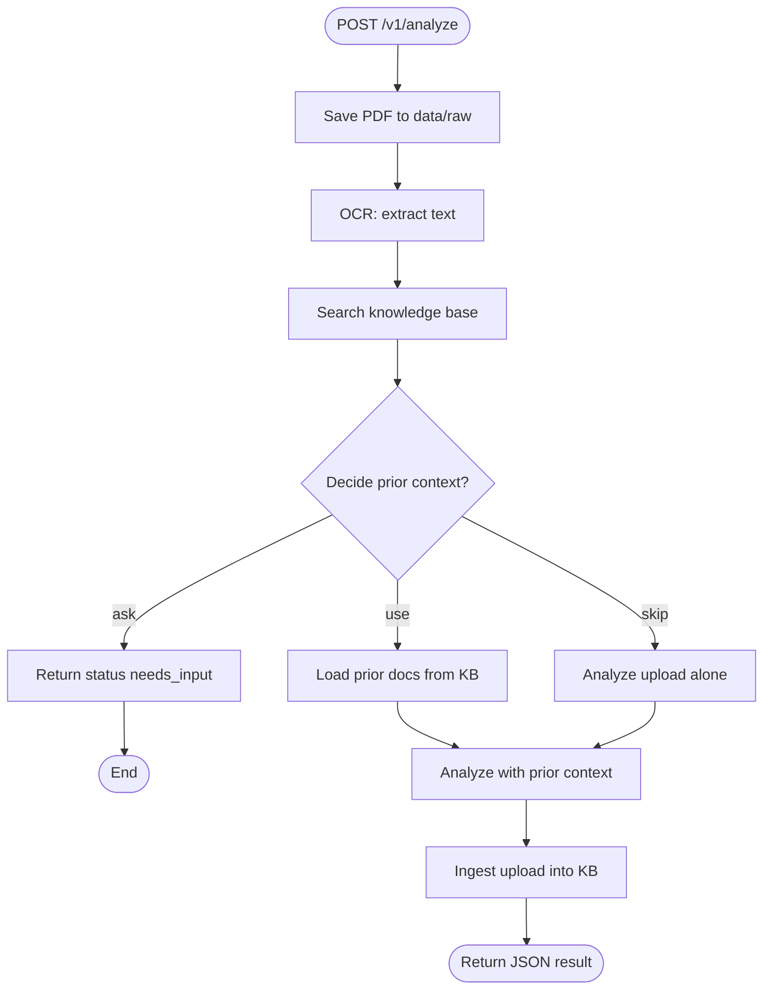

# Agentic AI

PDF upload → OCR → search similar documents → decide prior context → analyze.

## Glossary

| Term | Meaning |
|---|---|
| Goal | Definition of done for an agent |
| Perception | What the agent can observe right now (upload path, OCR text/confidence, search hits) — evidence, not a decision |
| Action | A step that changes state or produces output |
| Tool | Executable action (`ocr`, `search`, `ingest`) |
| Skill | Playbook for when/how to use a capability or make a decision |
| Decision | Choosing among options given perception + policy (`use` / `skip` / `ask`) |
| Planning | Ordering steps toward the goal (here: fixed pipeline in the agent) |
| Memory | Stored information across steps or sessions (working, semantic, episodic) |
| Policy | Rules for allowed tools, writes, and when to ask the user |
| Environment | Outside world the agent acts in: uploads, stores, `data/` |
| Observability | Logs, traces, and metrics that show what the agent did |

## Agentic coverage (MVP)

| Concept | Status | Where |
|---|---|---|
| Goal | Done | `agents/pdf_analyst/goals.yaml` |
| Environment | Done | `environment/` + `data/` |
| Perception | Done | OCR output + search hits fed into decide/analyze |
| Tools / actions | Done | `tools/{ocr,search,ingest}` |
| Skills | Done | `skills/` (incl. decide + analyze) |
| Decision | Done | `skills/decide_prior_context` |
| Policy | Done | `config/policy.yaml` |
| LLM | Done | `llm/` + `config/model.yaml` |
| Agent loop | Partial | Scripted in `PdfAnalystAgent.run` (not LLM-chosen tools) |
| Planning | Partial | Hardcoded OCR → search → decide → analyze → ingest |
| Memory (semantic) | Done | Knowledge base via `environment/stores` |
| Memory (working) | Partial | `memory/working.py` exists; agent barely uses it |
| Memory (episodic) | Missing | No durable log of past decisions/outcomes |
| Observability | Missing | Only uvicorn access logs; `config/logging.yaml` not wired |
| Evals | Scaffold | `evals/` folders present; suite not fully built |

**MVP complete for:** goal → perceive → decide → act → store in KB.  
**Next maturity layer:** wire logging, use working memory in the agent, episodic decision log, richer evals.

## Setup

```bash
python -m venv .venv
# Windows
.venv\Scripts\activate
# macOS/Linux
# source .venv/bin/activate

pip install -e ".[dev]"
copy .env.example .env   # or: cp .env.example .env
```

Set `GROQ_API_KEY` in `.env` (default LLM provider is Groq).

Generate and seed sample PDFs:

```bash
python scripts/generate_sample_pdfs.py
python scripts/seed_knowledge_base.py
```

Run the API:

```bash
uvicorn agentic_ai.api.app:app --reload
```

- Health: `GET http://127.0.0.1:8000/health`
- Ingest: `POST /v1/ingest` (multipart file)
- Analyze: `POST /v1/analyze` (multipart file) — full agent flow
- Search: `GET /v1/search?q=Acme+invoice`

Example analyze upload (PowerShell):

```powershell
curl.exe -X POST "http://127.0.0.1:8000/v1/analyze" -F "file=@data/raw/samples/invoice_acme_2024_q2.pdf"
```

## Switch LLM providers

Edit [`config/model.yaml`](config/model.yaml) only — no code changes.

**Groq (default)**

```yaml
provider: groq
model: openai/gpt-oss-20b
# heavier: openai/gpt-oss-120b
```

**Gemini**

```yaml
provider: gemini
model: gemini-2.0-flash
```

Set `GEMINI_API_KEY` in `.env`.

**Internal / private OpenAI-compatible LLM**

```yaml
provider: openai_compatible
model: company-chat-v1
base_url: http://llm.internal.company:8000/v1
api_key_env: INTERNAL_LLM_API_KEY
```

Set `INTERNAL_LLM_API_KEY` in `.env`. Works with vLLM, Ollama (`/v1`), company gateways, etc.

Optional escape hatch: set `model_id` to any LiteLLM route (e.g. `openai/my-model`).

## Architecture

Flow when you call `POST /v1/analyze` (with decide branches):




**Which modules run at each step**

| Step | Module |
|---|---|
| Save upload | `api` → `environment/uploads` |
| OCR | `tools/ocr` |
| Search | `tools/search` → `environment/stores` → `data/knowledge_base` |
| Decide | `skills/decide_prior_context` → `llm` + `config/policy.yaml` |
| Analyze | `skills/analyze_pdf` → `llm` |
| Ingest | `tools/ingest` → `data/processed` + KB |

## Layout

- `agentic_ai/tools/` — reusable executables
- `agentic_ai/skills/` — playbooks (generic + product-specific)
- `agentic_ai/agents/pdf_analyst/` — product agent loop
- `agentic_ai/llm/` — config-driven LiteLLM client
- `agentic_ai/environment/stores/` — knowledge base backend (Chroma + ONNX embeddings)
- `data/` — artifacts (`raw` → `processed` → `knowledge_base`)

## Reuse

Take elsewhere: `tools/{ocr,search,ingest}` and matching skills.  
Product-only: `pdf_analyst`, `decide_prior_context`, `analyze_pdf`.

## Tests

```bash
pytest
```
