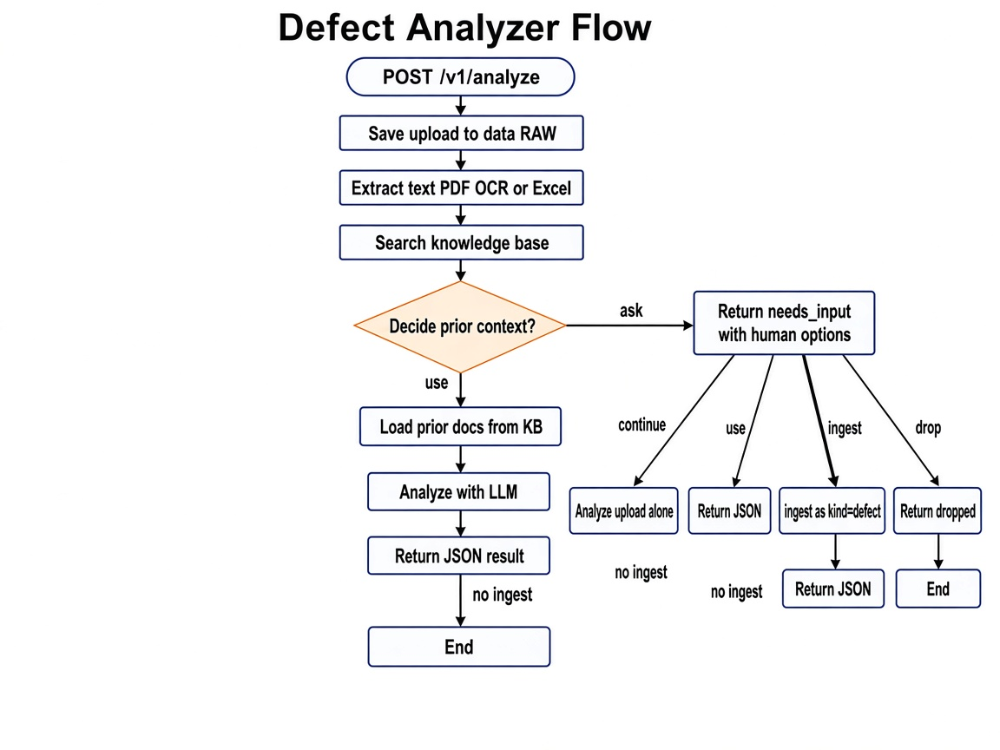
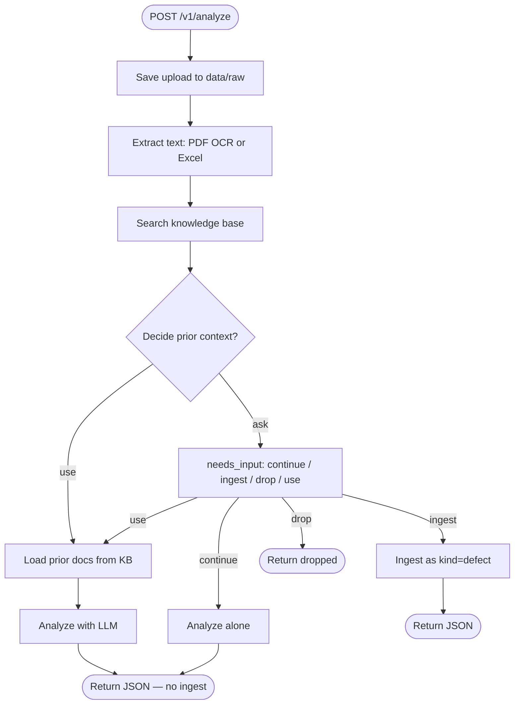

# Agentic AI

Defect report upload (PDF or Excel) → extract → search prior cases → decide → analyze → ingest.

## Glossary

| Term | Meaning |
|---|---|
| Goal | Definition of done for an agent |
| Perception | What the agent can observe right now (upload path, extract text/confidence, search hits) — evidence, not a decision |
| Action | A step that changes state or produces output |
| Tool | Executable action (shared extractors; agent search/ingest) |
| Skill | Playbook for when/how to use a capability or make a decision |
| Decision | Choosing among options given perception + policy (`use` / `skip` / `ask`) |
| Planning | Ordering steps toward the goal (here: fixed pipeline in the agent) |
| Memory | Stored information across steps or sessions (working, semantic, episodic) |
| Policy | Rules for allowed tools, writes, and when to ask the user |
| Environment | Outside world the agent acts in: uploads, stores, `data/` |
| Observability | Logs, traces, and metrics that show what the agent did |

## Agentic coverage (MVP)

| Concept | Status | Where |
|---|---|---|
| Goal | Done | `agents/defect_analyzer/goals.yaml` |
| Environment | Done | `shared/environment/` + `data/` |
| Perception | Done | Shared extract + agent search hits |
| Tools (shared) | Done | `shared/tools/{ocr,read_excel,extract}` |
| Skills (shared) | Done | Playbooks for OCR / read_excel |
| Skills (agent) | Done | search, decide, analyze_defect, ingest |
| Decision | Done | `decide_prior_context` |
| Policy | Done | `config/policy.yaml` |
| LLM | Done | `shared/llm/` + `config/model.yaml` |
| Agent loop | Partial | Scripted `DefectAnalyzer` (not LLM-chosen tools) |
| Planning | Partial | Hardcoded extract → search → decide → analyze → ingest |
| Memory (semantic) | Done | Knowledge base via `shared/environment/stores` |
| Memory (working) | Partial | `shared/memory/working.py` exists; agent barely uses it |
| Memory (episodic) | Missing | No durable log of past decisions/outcomes |
| Observability | Partial | Step + LLM prompt/response logs via `shared/logging_setup.py` |
| Evals | Scaffold | `evals/` folders present; suite not fully built |

**MVP complete for:** business agent (`DefectAnalyzer`) → perceive → decide → act → store in KB.  
**Next maturity layer:** working memory, episodic decision log, richer evals, more domain agents.

## Setup

```bash
python -m venv .venv
# Windows
.venv\Scripts\activate
# macOS/Linux
# source .venv/bin/activate

pip install -e ".[dev]"
copy .env.example .env   # or: cp .env.example .env
```

Set `GROQ_API_KEY` in `.env` (default LLM provider is Groq).

Generate and seed sample files:

```bash
python scripts/generate_sample_pdfs.py
python scripts/generate_sample_excel.py
python scripts/seed_knowledge_base.py
```

Run the API:

```bash
uvicorn agentic_ai.api.app:app --reload
```

- Health: `GET http://127.0.0.1:8000/health`
- Ingest: `POST /v1/ingest` (multipart file) → `DefectAnalyzer.ingest`
- Analyze: `POST /v1/analyze` → `DefectAnalyzer.run` (PDF or Excel)
- Search: `GET /v1/search?q=weld+crack` (defect-ranked)

Example analyze upload (PowerShell):

```powershell
curl.exe -X POST "http://127.0.0.1:8000/v1/analyze" -F "file=@data/raw/samples/invoice_acme_2024_q2.pdf"
```

## Switch LLM providers

Edit [`config/model.yaml`](config/model.yaml) only — no code changes.

**Groq (default)**

```yaml
provider: groq
model: openai/gpt-oss-20b
# heavier: openai/gpt-oss-120b
```

**Gemini**

```yaml
provider: gemini
model: gemini-2.0-flash
```

Set `GEMINI_API_KEY` in `.env`.

**Internal / private OpenAI-compatible LLM**

```yaml
provider: openai_compatible
model: company-chat-v1
base_url: http://llm.internal.company:8000/v1
api_key_env: INTERNAL_LLM_API_KEY
```

Set `INTERNAL_LLM_API_KEY` in `.env`. Works with vLLM, Ollama (`/v1`), company gateways, etc.

Optional escape hatch: set `model_id` to any LiteLLM route (e.g. `openai/my-model`).

## Architecture

Flow when you call `POST /v1/analyze`:





**Agent decide: `use` | `ask` only**

| Agent decision | Next |
|---|---|
| **use** | Analyze with priors only (**no** ingest) |
| **ask** | Human picks **continue** / **ingest** / **drop** / **use** |

**Ingest** only when the human chooses `ingest` under ask (or via `POST /v1/ingest` / `.ingest()`).

Resume after ask: `DefectAnalyzer.run(path, user_action="ingest")` (etc.).

**Which modules run at each step**

| Step | Module |
|---|---|
| Save upload | `api` → `shared/environment/uploads` |
| Extract | `shared/tools/extract` → OCR or read_excel |
| Search | `agents/defect_analyzer/skills/search` → knowledge base |
| Decide | `skills/decide_prior_context` → `use` \| `ask` |
| Analyze | `skills/analyze_defect` (use, or human continue/use) |
| Ingest | Only human `user_action=ingest` or dedicated ingest API |

## Layout

```text
agentic_ai/
  shared/                 # platform reused by every agent
    tools/                # ocr, read_excel, extract (format plumbing)
    skills/               # playbooks for shared extractors
    environment/          # uploads + knowledge_base store
    memory/
    llm/
    util/
  agents/
    defect_analyzer/      # business agent (only agent for now)
      skills/search, decide_prior_context, analyze_defect, ingest
      prompts/
      agent.py            # DefectAnalyzer public object
  api/                    # routes call DefectAnalyzer
```

## Reuse

- **Shared:** store + LLM + format extractors (`ocr` / `read_excel`)
- **Public reuse unit:** `DefectAnalyzer` (import the agent object)
- **Agent-owned:** domain search, decide, analyze, ingest (tags `kind=defect`)

## Tests

```bash
pytest
```
